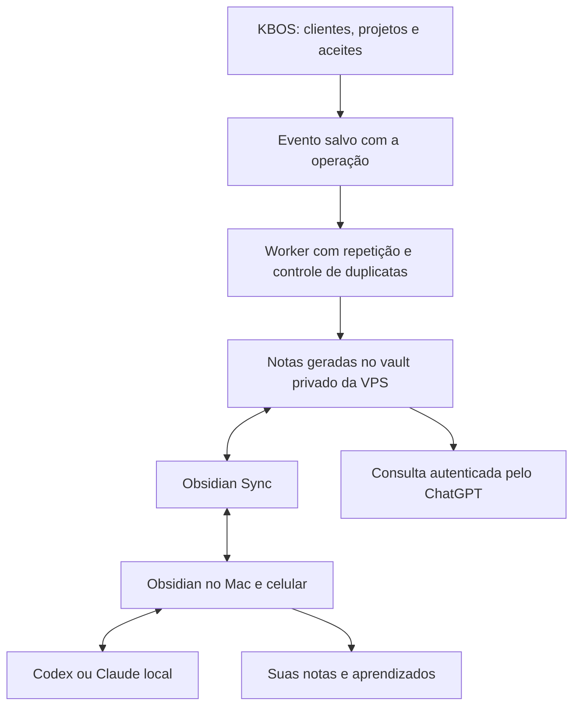

# Segundo cérebro — fluxo recomendado para Kayque

Pesquisa e diagnóstico em 18/10/2026. Exportação operacional implementada no worker; sincronização com o vault pessoal e conexões das IAs ainda dependem da ativação descrita abaixo. Hermes não instalado.

## Implantação atual

A VPS foi medida pelo console Hostinger em 18/10, 13:41 UTC: 7.940 MiB totais, 5.573 MiB disponíveis; carga 0,06 / 0,06 / 0,18; disco de 96 GB com 29 GB disponíveis. É uma fotografia, não uma medição de pico. Worker ~86 MiB, web ~62 MiB, Evolution ~118 MiB, Whisper ~700 MiB. Há folga para Markdown e headless, mantendo limites.

O worker agora reconcilia o estado do KBOS a cada cinco minutos em `/vault/40-KBOS-Automatico`, no volume persistente `kbos_brain-vault`. Exporta contatos, projetos e versões publicadas de planejamento. Não exporta documentos pessoais, endereço, senhas, tokens, conversas, rascunhos ou dados bancários. As fichas são separadas das notas humanas. Gravações atômicas, histórico local e propostas na pasta Conflitos preservam edições. Registros removidos recebem aviso de remoção; o histórico privado permanece no servidor.

Esta primeira versão reconcilia o **estado atual**: não registra cada mudança intermediária entre duas varreduras. A outbox transacional descrita no estudo continua como evolução para eventos e linha do tempo completos. Histórico no mesmo volume não substitui backup externo.

O serviço opcional `brain-sync` usa o pacote oficial `obsidian-headless@0.0.14`, Node 22, limite de 256 MiB / 0,25 CPU e nenhum acesso a banco, Docker, segredos do KBOS ou portas públicas. Ele compartilha somente o vault e tem volume próprio para credenciais. Não é iniciado automaticamente.

### Ativação com Obsidian Sync (titular)

Antes de conectar: backup do vault existente no Mac; ativar Sync nele e criar o vault remoto com criptografia de ponta a ponta. Não criar outro vault vazio sobre o existente. Contratação e senha são preenchidas pelo titular.

Na raiz `/opt/kbos`, sempre com o `.env` correto:

```sh
docker compose --env-file /opt/kbos/.env -f infra/docker-compose.yml --profile brain-sync build brain-sync
docker compose --env-file /opt/kbos/.env -f infra/docker-compose.yml --profile brain-sync run --rm brain-sync login
docker compose --env-file /opt/kbos/.env -f infra/docker-compose.yml --profile brain-sync run --rm brain-sync sync-list-remote
docker compose --env-file /opt/kbos/.env -f infra/docker-compose.yml --profile brain-sync run --rm brain-sync sync-setup --vault "NOME DO VAULT EXISTENTE" --path /vault
docker compose --env-file /opt/kbos/.env -f infra/docker-compose.yml --profile brain-sync run --rm brain-sync sync-config --path /vault --conflict-strategy conflict --configs ""
docker compose --env-file /opt/kbos/.env -f infra/docker-compose.yml --profile brain-sync up -d brain-sync
```

Não passar senha por argumento, chat ou histórico. Preferir prompts interativos. Conferir uma nota de teste em cada direção antes de considerar concluído. Conectores autenticados para ChatGPT/Claude/Gemini são uma etapa separada: Sync não dá memória automática aos modelos. Nenhum MCP público foi exposto por esta implementação.


## Escolha recomendada

Manter um vault privado do Obsidian, sincronizado entre Mac/celular e uma cópia de trabalho na VPS. Começar com **Obsidian Sync + cliente oficial headless**, um exportador determinístico do KBOS e o acesso local já disponível ao Codex/Claude. Acrescentar Hermes somente quando houver uma rotina que precise dele e depois de medir a VPS.

O Obsidian é a base durável e portátil. ChatGPT, Claude e Hermes são interfaces para consultar e elaborar esse conhecimento. A memória interna de qualquer agente não substitui as notas.

O vault atual já tem uma boa estrutura: contexto, marca, voz e tom, serviços, projetos, clientes e templates. Não há motivo para recriá-lo. Há ao menos um fato desatualizado no contexto mestre: o agente de WhatsApp aparece como pendente, mas já foi validado. A primeira melhoria é registrar origem e data de confirmação para evitar memórias antigas tratadas como atuais.

## Fluxo proposto



### O que cada lugar governa

| Informação | Fonte principal | Como chega às notas |
|---|---|---|
| Contato, status, projeto, prazo e aceite | KBOS | Exportação automática, sem IA inventar ou reinterpretar |
| Marca aprovada, tom e planejamento | Versão aprovada no KBOS + manual de origem | Registro da versão e link para o documento |
| Conversas, decisões e aprendizados | Notas revisadas por Kayque | Resumo com fonte e data; proposta de alteração para pontos sensíveis |
| Voz, limites e posicionamento pessoal | `00-Contexto` | Edição consciente, com histórico |
| Senhas, tokens e chaves de API | Gerenciador de segredos | Nunca no vault, no prompt ou em arquivos de cliente |

Editar uma nota não deve alterar silenciosamente preço, contrato ou status no KBOS. No começo, a direção operacional é KBOS → notas. Uma futura ferramenta de escrita de volta ao KBOS deve ter ações específicas e confirmação.

### Eventos que alimentam o segundo cérebro

- Contato criado ou atualizado: ficha e vínculo ao identificador do contato.
- Projeto criado ou alterado: escopo, etapa, datas e vínculos.
- Proposta aceita: registro do aceite, projeto e identidade confirmada.
- Planejamento publicado/aprovado: versão, situação e histórico resumido.
- Tarefa concluída ou mudança relevante: entrada datada na linha do tempo; não copiar cada interação irrelevante.

Salvar o evento na mesma transação do dado principal, com chave de deduplicação. O worker tenta novamente em caso de falha; um reconciliador compara o estado do KBOS e as notas para reparar eventos perdidos. Assim o Mac desligado não faz perder atualizações.

### Arquivos e conflitos

Preservar suas pastas atuais. Cada cliente/projeto recebe ID estável no frontmatter e uma seção automática claramente delimitada. Anotações humanas ficam fora dessa seção e não são sobrescritas. Outra opção ainda mais segura é uma nota gerada separada, vinculada à ficha humana.

Campos sugeridos: `kbos_id`, `tipo`, `fonte`, `atualizado_em`, `versao`, `status`, `revisado_por`. Gravação em arquivo temporário + renomeação atômica; alteração humana concorrente gera conflito para revisão. Nunca usar `rsync --delete` ou sobrescrever o vault inteiro.

No servidor, usar volume persistente fora da pasta de releases do KBOS, usuário sem privilégios e permissão apenas às pastas necessárias. Começar sincronizando Markdown e pequenos anexos; vídeos e binários grandes permanecem em armazenamento de arquivos e são referenciados por links autenticados. Obsidian Sync não substitui backup independente, criptografado e testado.

## ChatGPT e Codex

**Aqui no Codex local**, o vault já pode ser lido por ferramentas de arquivo, como nesta análise. Não precisa instalar o Hermes para isso. Acesso de escrita continua sujeito às permissões locais.

**No ChatGPT web/celular**, uma pasta do Mac não fica automaticamente acessível. O caminho é uma integração autenticada com ferramentas específicas, como `buscar_notas`, `ler_nota`, `propor_atualizacao` e `registrar_decisao`. O MCP oferece essa ponte; não é necessário publicar o conteúdo do vault na web. A configuração e a disponibilidade precisam ser conferidas na conta.

Não expor uma API de arquivos sem autenticação nem oferecer terminal irrestrito para o vault. A primeira versão deve ler apenas a base autorizada; escritas ficam limitadas a pastas/seções próprias e revisões. Não prometer que qualquer conversa do ChatGPT será automaticamente salva: isso precisa de ferramenta chamada e gravação confirmada.

## VPS e Hermes

O HANDOFF registra 2 vCPU / 8 GB e serviços KBOS, worker, Redis e Evolution. A medição pelo console está registrada acima. A saúde da aplicação não informa folga de RAM, e ainda não medimos picos de build.

Um exportador de Markdown aproveitando o worker existente adiciona menos componentes e pontos de falha que outro agente sempre ativo. Arquivos de texto são pequenos; o risco de consumo vem do runtime, navegadores, indexadores, tarefas simultâneas e modelos locais.

Minha escolha agora: **sem Hermes na VPS de produção**. Usar LLM por API, sem modelo local, e medir durante os picos de deploy e uso do WhatsApp. Se Hermes vier depois, iniciar com uma tarefa por vez, limites de CPU/memória, sem navegador e sem acesso ao Docker/segredos do KBOS. Para navegação, múltiplos agentes ou trabalhos pesados, preferir outra VPS.

A memória nativa do Hermes é compacta e limitada; ela guarda referências e preferências, não todo o arquivo de clientes. O próprio projeto orienta não compartilhar o mesmo diretório de estado entre dois agentes concorrentes.

## Escolha da sincronização

| Opção | Avaliação para este caso |
|---|---|
| Obsidian Sync + headless oficial | Recomendada para Mac, celular e servidor, com histórico e criptografia de ponta a ponta |
| Git privado | Boa alternativa para Markdown e histórico técnico; exige tratar conflitos e facilitar o uso no celular |
| Sincronizar direto com o Mac | Pode servir como começo econômico, mas as atualizações só chegam quando o Mac estiver online |
| iCloud junto com outro sincronizador no mesmo vault | Evitar misturar dois responsáveis pela mesma árvore; escolher um mecanismo e testar a migração |

O Sync é pago. Verificar plano, limite de arquivos e preço antes de contratar. Não foi criada conta nem assinatura nesta tarefa.

## Ordem de implantação

1. Backup e revisão dos arquivos atuais; atualizar fatos desatualizados.
2. Escolher a sincronização e conectar uma cópia de teste, sem substituir o vault original.
3. Implementar outbox/exportador do KBOS e validar criação, alteração, repetição, conflito e recuperação após indisponibilidade.
4. Ativar somente clientes/projetos e versões aprovadas; acompanhar a fila de sincronização.
5. Oferecer busca/leitura autenticada ao ChatGPT e escrita controlada para decisões e aprendizados.
6. Avaliar Hermes depois de medir uso real e identificar uma função que ainda esteja faltando.

## Fontes consultadas

- [Obsidian Sync](https://obsidian.md/sync): sincronização, criptografia, histórico e planos.
- [Obsidian Headless oficial](https://github.com/obsidianmd/obsidian-headless): sincronização sem aplicativo desktop e opções de conflito/exclusão.
- [MCP no ChatGPT](https://developers.openai.com/plugins/build/app-quickstart): conexão de ferramentas autenticadas.
- [MCP no Codex](https://learn.chatgpt.com/docs/extend/mcp?surface=cli): extensão do acesso a ferramentas.
- [Memória do Hermes](https://hermes-agent.nousresearch.com/docs/user-guide/features/memory): limites e concorrência.
- [Instalação do Hermes](https://hermes-agent.nousresearch.com/docs/getting-started/installation): componentes opcionais e ferramentas de navegador.
